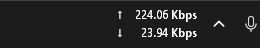
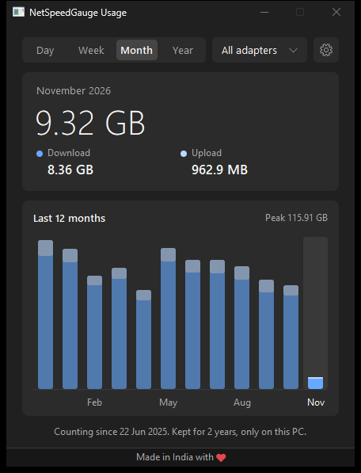
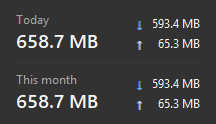

# NetSpeedGauge: Internet Speed Monitor for Windows Taskbar

Shows your internet upload and download speed on the Windows taskbar, and how much data you used today, this week, this month and this year.

Uses under 4 MB of RAM. Never connects to the internet. Free and open source.

**[Download for Windows](https://github.com/developedByAshu/NetSpeedGauge-Internet-Speed-Monitor/releases/latest)**



## Screenshots






The usage screenshot uses sample data.

## What it does

**Speed**
- Live upload and download speed on the taskbar
- Counts Wi-Fi, LAN, Wi-Fi Direct and Bluetooth together, or only the adapters you choose
- VPN traffic counts once, on the real adapter
- Mbps, MBps, Mibps or MiBps, with your choice of decimals

**Data usage**
- Day, week, month and year charts, kept for up to 2 years
- Split by adapter
- Hover over the numbers to see today and this month
- Downloads still count if the app was closed, as long as Windows did not restart

**Look**
- Light, dark or same as Windows
- Choose the arrows, thickness, colours, font, size and background
- Colours can change with speed

## Size on my PC

Measured on Windows 11 over 20 minutes of normal use. Yours may differ.

| What | Measured |
|---|---|
| Download | 404 KB, one file, nothing to install |
| RAM on the taskbar | 1.5 to 3.8 MB |
| RAM with Usage open | 6.4 MB |
| RAM with Settings open | 4.9 MB |
| CPU | 0.013% of the whole processor |

Usage and Settings only exist while open, and give their memory back when you close them.

## Privacy

- Nothing leaves your PC. There is no account, tracking, ads or server.
- The program has no network library in it. It only reads your adapters' byte counts from Windows.
- Your usage and settings stay in `%APPDATA%\NetSpeedGauge`. They are not encrypted, they are just never sent anywhere.

The code is here, so you can check all of this.

## Install

1. Download `NetSpeedGauge-x64.exe` from [Releases](https://github.com/developedByAshu/NetSpeedGauge-Internet-Speed-Monitor/releases/latest). On a Windows on ARM PC, take `NetSpeedGauge-arm64.exe`.
2. Put it in a folder you will keep, then run it.
3. To open it at sign in, turn on **Start with Windows** in Settings.

Windows may show a SmartScreen warning because the program is not code signed yet. Choose **More info**, then **Run anyway**. `SHA256SUMS.txt` in each release lets you check the file.

To remove it, turn off **Start with Windows**, choose **Exit**, then delete the file and `%APPDATA%\NetSpeedGauge`.

## Works on

Tested on Windows 11. It should also work on Windows 10 and Windows on ARM, but I have not tested those. If something breaks, open an issue or message me on GitHub.

It shows on the main taskbar only.

## Common questions

**How do I see internet speed on the Windows 11 taskbar?**
Run NetSpeedGauge. The speed appears beside the system tray.

**How do I check how much data I used this month on Windows?**
Click the numbers or right-click them and choose **Usage**, then pick **Month**.

**Does it show Mbps or MBps?**
Either. Change it under **Settings**, **Units**.

**Does it slow down my PC or use my data?**
No data, because it never connects to the internet. For CPU and RAM, see the table above.

**Why are other adapters missing from the Usage list?**
An adapter appears there after data has moved through it. Settings lists all of them.

## Build it yourself

You need Rust and the Visual Studio C++ build tools.

```
cargo test --release
cargo build --release
```

The program ends up in `target\release\NetSpeedGauge.exe`.

## Licence

[GPL-3.0](LICENSE)

Made in India by Ashutosh Anand.
