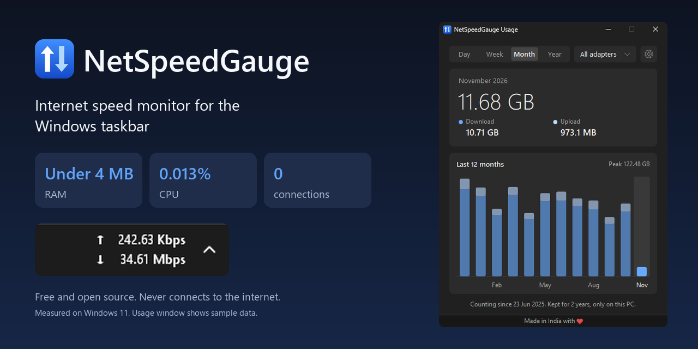
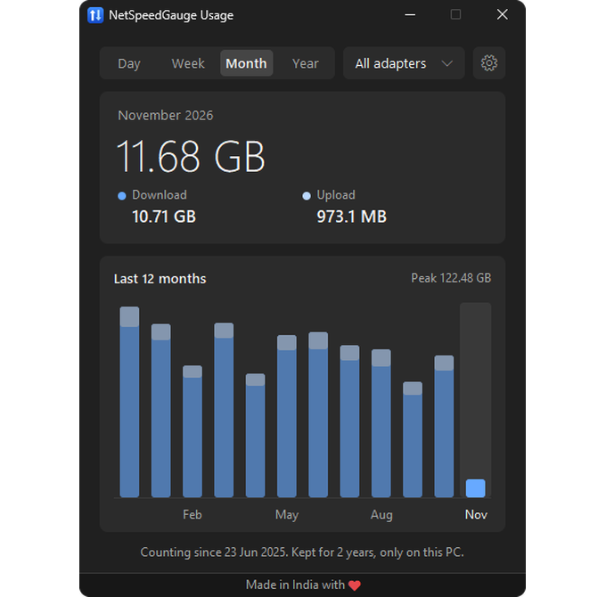
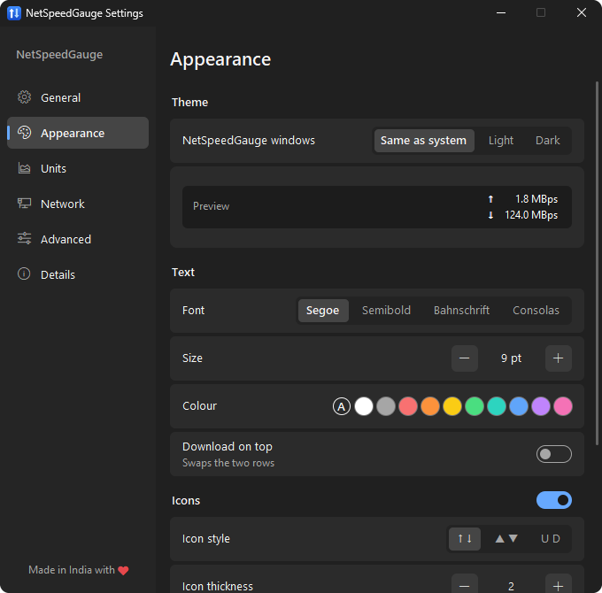
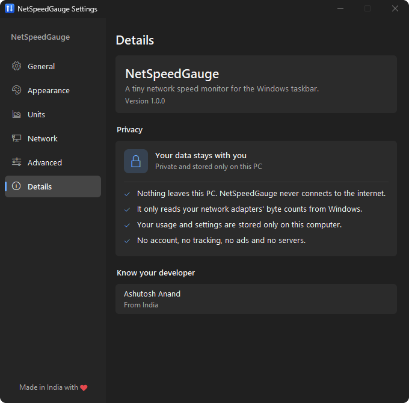
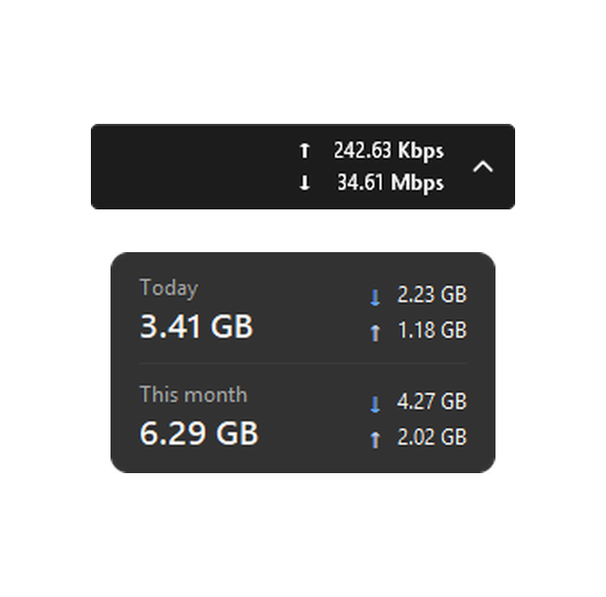

<h1 align="center">NetSpeedGauge (Internet Speed Meter)</h1>

<p align="center">
  
</p>

<p align="center">
  A tiny internet speed monitor for the Windows taskbar. See your upload and download speed, and how much data you used today, this week, this month and this year.
</p>

<p align="center">
  <a href="https://github.com/developedByAshu/NetSpeedGauge-Internet-Speed-Monitor/releases/latest"></a>
</p>

<p align="center">
  
  
  
</p>

<table align="center">
  <tr>
    <td align="center" width="170"><h3>Under 4 MB</h3>RAM on the taskbar</td>
    <td align="center" width="170"><h3>0.013%</h3>CPU</td>
    <td align="center" width="170"><h3>408 KB</h3>one file, no install</td>
    <td align="center" width="170"><h3>0</h3>internet connections</td>
  </tr>
</table>

## Why I built it

I tried the taskbar speed monitors out there. One missed most of my downloads because it followed a single adapter. Another showed the right speed but used about 79 MB of RAM. Some had no usage history at all.

So this one counts every adapter, keeps 2 years of history, and stays out of the way.

## Screenshots

<table>
  <tr>
    <td width="50%" align="center"><br><sub>Usage by day, week, month and year (sample data)</sub></td>
    <td width="50%" align="center"><br><sub>Make it look the way you want</sub></td>
  </tr>
  <tr>
    <td width="50%" align="center"><br><sub>Your data stays with you</sub></td>
    <td width="50%" align="center"><br><sub>On the taskbar. Hover for today and this month</sub></td>
  </tr>
</table>

## What it does

<table>
  <tr>
    <td valign="top" width="33%">
      <b>Speed</b>
      <ul>
        <li>Live upload and download speed</li>
        <li>Wi-Fi, LAN, Wi-Fi Direct and Bluetooth together, or only the adapters you pick</li>
        <li>VPN traffic counts once</li>
        <li>Mbps, MBps, Mibps or MiBps</li>
      </ul>
    </td>
    <td valign="top" width="33%">
      <b>Data usage</b>
      <ul>
        <li>Day, week, month and year charts</li>
        <li>Kept for up to 2 years</li>
        <li>Split by adapter</li>
        <li>Keeps counting across Windows restarts</li>
        <li>Closed the app? It catches up when you reopen it, if Windows has not restarted since</li>
      </ul>
    </td>
    <td valign="top" width="33%">
      <b>Look</b>
      <ul>
        <li>Light, dark or same as Windows</li>
        <li>Icons, thickness, colours, font, size and background</li>
        <li>Colours can change with speed</li>
        <li>Your colours follow into Usage and the hover card</li>
        <li>Choose what hover and click open</li>
      </ul>
    </td>
  </tr>
</table>

## Install

1. Download `NetSpeedGauge-x64.exe` from [Releases](https://github.com/developedByAshu/NetSpeedGauge-Internet-Speed-Monitor/releases/latest). On a Windows on ARM PC, take `NetSpeedGauge-arm64.exe`.
2. Put it in a folder you will keep, then run it.
3. To open it at sign in, turn on **Start with Windows** in Settings.

To update, choose **Exit**, then replace the old file with the new one. Your settings and usage stay as they are.

Windows may show a SmartScreen warning because the program is not code signed yet. Choose **More info**, then **Run anyway**. `SHA256SUMS.txt` in each release lets you check the file.

To remove it, turn off **Start with Windows**, choose **Exit**, then delete the file and `%APPDATA%\NetSpeedGauge`.

## Works on

Tested on Windows 11. It should also work on Windows 10 and Windows on ARM, but I have not tested those. If something breaks, open an issue or message me on GitHub.

It shows on the main taskbar only.

<table>
  <tr>
    <td valign="top" width="50%">
      <h2>Privacy</h2>
      <ul>
        <li>Nothing leaves your PC. No account, tracking, ads or server.</li>
        <li>No network library in the program. It only reads your adapters' byte counts from Windows.</li>
        <li>Usage and settings stay in <code>%APPDATA%\NetSpeedGauge</code>. They are not encrypted, they are just never sent anywhere.</li>
        <li>The code is all here, so you can check it yourself or ask an AI to.</li>
      </ul>
    </td>
    <td valign="top" width="50%">
      <h2>Size on my PC</h2>
      <table>
        <tr><td>RAM on the taskbar</td><td>1.7 to 2.9 MB</td></tr>
        <tr><td>RAM with Usage open</td><td>4.3 MB</td></tr>
        <tr><td>RAM with Settings open</td><td>6.1 MB</td></tr>
        <tr><td>CPU</td><td>0.013% of the processor</td></tr>
        <tr><td>Download</td><td>408 KB</td></tr>
      </table>
      <sub>Windows 11, 10 minutes of normal use. Yours may differ. Usage and Settings give their memory back when closed.</sub>
    </td>
  </tr>
</table>

## Common questions

<details>
<summary><b>How do I see internet speed on the Windows 11 taskbar?</b></summary>
<br>Run NetSpeedGauge. The speed appears beside the system tray.
</details>

<details>
<summary><b>How do I check how much data I used this month on Windows?</b></summary>
<br>Click the numbers, or right-click them and choose <b>Usage</b>, then pick <b>Month</b>.
</details>

<details>
<summary><b>Does it show Mbps or MBps?</b></summary>
<br>Either. Change it under <b>Settings</b>, <b>Units</b>.
</details>

<details>
<summary><b>Does it slow down my PC or use my data?</b></summary>
<br>No data, because it never connects to the internet. For CPU and RAM, see the numbers above.
</details>

<details>
<summary><b>Why are other adapters missing from the Usage list?</b></summary>
<br>An adapter appears there after data has moved through it. Settings lists all of them.
</details>

## Build it yourself

You need Rust and the Visual Studio C++ build tools.

```
cargo test --release
cargo build --release
```

The program ends up in `target\release\NetSpeedGauge.exe`.

## Licence

[GPL-3.0](LICENSE)
